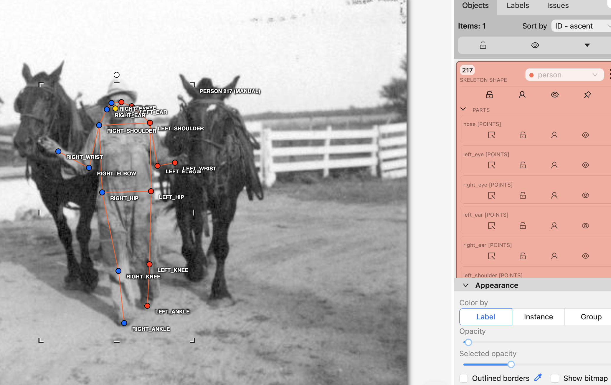
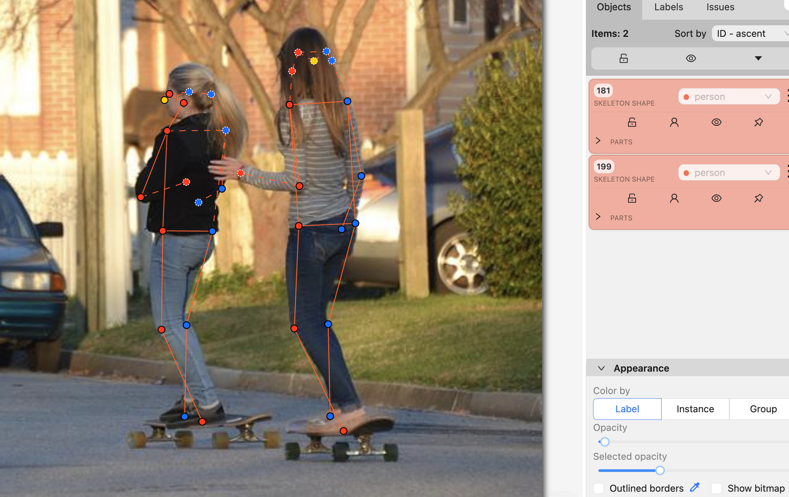
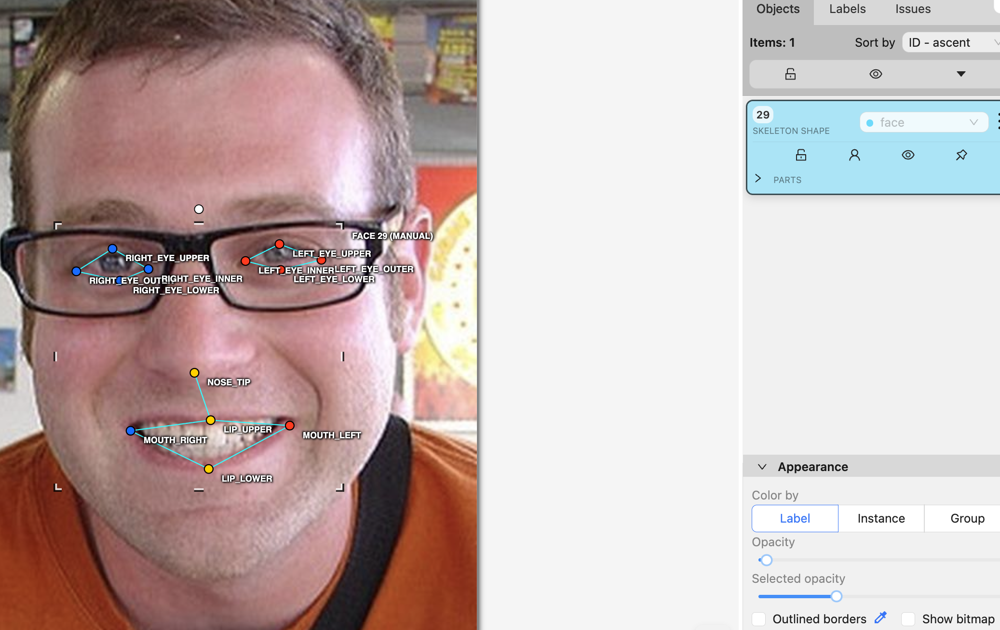
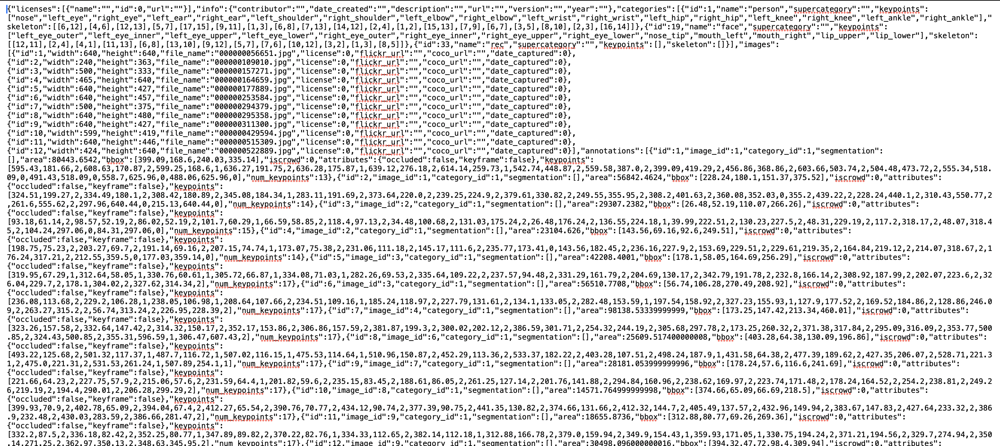

# Báo cáo cá nhân — HoangManhHung-2A202604046

Đổi tên file theo quy tắc `MSSV_HoTen.md`. Ví dụ: `20241234_NguyenVanAn.md`.

Dữ liệu: 12 ảnh người COCO val2017 (Lin et al., 2014) và 8 ảnh chân dung Wikimedia Commons, chỉ dùng trong lớp.

## 0. Thông tin học viên

- Họ tên: Hoàng Mạnh Hùng
- MSSV: 2A202604046
- Email: 26ai.hunghm@vinuni.edu.vn
- Link repository: https://github.com/hung096849/K5-L2B-Day04-HoangManhHung-2A202604046-KeypointPose-Student
- Phiên bản CVAT (Help → About):
- Máy: hệ điều hành MacOs · RAM 16 GB · chạy CVAT chế độ đầy đủ / lite
- Bộ ảnh (`src/exports/assignment.json` do `lab.py setup` tạo): có
- Giờ bắt đầu: 4h30
- Giờ kết thúc: 7h30

## 1. Kiểm tra label (CP0)

| Label | Kiểu | Số điểm | Tên điểm đúng bảng của lab? | Đúng thứ tự? | Số cạnh |
|---|---|---:|---|---|---:|
| `person` | Skeleton | 17 | Có | Có | 19 |
| `face` | Skeleton | 13 | Có | Có | 13 |

Mẫu `person` dựng theo người quay mặt về camera (các điểm `left_*` nằm bên phải khung mẫu)? Có 

Cách đổi cờ `occluded` / `outside` cho **một điểm** trên phiên bản CVAT này (một câu):

chỉ cần chọn switch occluded property /switch outside property trong phần part của một skeleton shape

## 2. Số lượng đã gán và thời gian (CP1, CP2)

| Nhóm ảnh | Số ảnh | Số skeleton đã gán | Số người dưới 60 px (không gán) | Số poster / gương / màn hình bỏ qua | Thời gian (phút) |
|---|---:|---:|---:|---:|---:|
| `easy` | 5 | 7 | 1 | 0 | 20 |
| `occluded` | 3 | 8 | 7 | 5 | 30 |
| `back` | 2 | 3 | 4 | 0 | 25 |
| `small` | 1 | 2 | 1 | 6 | 5 |
| `crowd` | 1 | 1 | 1 | 5 | 5 |
| `faces` | 8 | 8 | — | 0 | 30 |

- Số ảnh người đã xong ở mốc phút 105: 0 / 10 (Xong trước)
- Thời gian thực tế (phút): CP1:85  · CP2:30 · CP3:35
- Ảnh tốn thời gian nhất là ảnh nào, vì sao? Ảnh 000000515309.jpg, vì người mặc bộ đồ lái xe mô tô và quay lưng, khó xác nhận điểm chính xác

...

## 3. Bảng ca khó (CP1, CP2)

Mỗi điểm bạn phân vân một dòng, nhất là phân vân giữa `v = 1` và `v = 0`, hoặc không chắc hướng người.

| Ảnh | Người / mặt | Điểm | Cờ đã chọn | Phân vân giữa | Lý do chọn |
|---|---|---|---:|---|---|
| | | | | | |
| | | | | | |
| | | | | | |

## 4. Bảng tự review (CP3)

Đi từ ảnh cuối về ảnh đầu. 5 ảnh người (ít nhất 2 ảnh `back` hoặc `crowd`) và 3 ảnh mặt. Ít nhất 8 dòng, kể cả dòng `ok`. Ghi lỗi trước, sửa sau.

Mã lỗi dùng đúng một trong: `lr_swap`, `vis_flag`, `position`, `missing`, `extra`, `ok`.

| Ảnh | Người / mặt | Điểm | Mã lỗi | Ghi chú | Đã sửa? |
|---|---|---|---|---|---|
| 000000515309.jpg | người | 17 | ok | | |
| 000000522889.jpg | ngưởi | 17 | ok | | |
| 000000429594.jpg | người | 17 | ok | | |
| 000000311300.jpg | người | 34 | ok | | |
| 000000295358.jpg | người | 17 | ok | | |
| face_38721.jpg | mặt | 13 | ok | | |
| face_204787.jpg | mặt | 13 | ok | | |
| face_559185.jpg | mặt | 13 | ok | | |

Tổng hợp số lỗi theo mã:

| `lr_swap` | `vis_flag` | `position` | `missing` | `extra` | `ok` |
|---:|---:|---:|---:|---:|---:|
| | | | | | 20 |

Điểm còn phân vân giữa `v = 1` và `v = 0` (ghi cả hai lựa chọn và lý do chọn):

ẢNh 000000056651.jpg, không xác định rõ điểm đầu gối của người giơ bánh kem bị cắt hay bị che. Quyết định cuối cùng là để v=0 vì không đoán được

## 5. Kiểm file xuất và kết quả tự kiểm (CP4)

Tự kiểm tay trong file JSON:

| File | Người / mặt kiểm (ảnh, thứ tự) | Số phần tử `keypoints` | Điểm `outside` ra `v = 0`, `occluded` ra `v = 1`? | `num_keypoints` khớp? |
|---|---|---:|---|---|
| `HoangManhHung_persons.zip` |000000056651.jpg, người thứ 1 | 51 | Có| 13|
| `HoangManhHung_persons.zip` | 000000109010.jpg, người thứ 1| 51|Có | 15|
| `HoangManhHung_faces.zip` |face_185015.jpg | 39| Có| 13|

Sau khi xuất, CVAT ghi `occluded` thành `v = 1` và `outside` thành `v = 0`. Tọa độ của điểm `outside` trong file là tọa độ cũ (CVAT 2.x xuất như vậy, không phải `0, 0`).

Hai job đã chuyển sang completed trên CVAT? Có

Dán phần **TÓM TẮT** in ra từ `src/check_submission.py`:

----- TÓM TẮT (dán vào báo cáo mục 5) -----
- File person: HoangManhHung_persons.zip
  Số ảnh: 12 · số skeleton `person`: 15 · mỗi annotation 51 số
  Skeleton theo ảnh: 000000056651=2, 000000109010=2, 000000157271=2, 000000164659=1, 000000177889=0, 000000253584=1, 000000294379=1, 000000295358=1, 000000311300=2, 000000429594=1, 000000515309=1, 000000522889=1
  Cờ v: v=2 197 (77%) · v=1 46 (18%) · v=0 12 (5%)
  num_keypoints trung bình: 16.2
- File face: HoangManhHung_faces.zip
  Số ảnh: 8 · số skeleton `face`: 8 · mỗi annotation 39 số
  Skeleton theo ảnh: face_145621=1, face_147624=1, face_178208=1, face_185015=1, face_204787=1, face_255797=1, face_38721=1, face_559185=1
  Cờ v: v=2 88 (85%) · v=1 16 (15%) · v=0 0 (0%)
  num_keypoints trung bình: 13.0
- Ghi chú: 12 điểm v = 0 vẫn mang tọa độ cũ (CVAT 2.x xuất như vậy; chuẩn COCO ghi 0, 0). Không phải lỗi: điểm v = 0 bị bỏ qua khi huấn luyện và khi chấm.
- Số [LỖI]: 0 · số [CẢNH BÁO]: 5
Kết quả: ĐẠT (đọc lại từng cảnh báo ở trên)

Các `[CẢNH BÁO]` còn giữ nguyên và lý do:

Có một cảnh báo về ảnh không có gán nhãn person nào. Vì person trong ảnh đó dưới 60px nên không gán nhãn. Các cảnh báo còn lại về vị trí và nghi ngờ các bộ phận bị khuất trong ảnh. Vẫn giữ nguyên vì gán đúng

## 6. Ảnh chụp màn hình

1. Label `person` trong label constructor (đủ 17 điểm có tên):

   

2. Một người quay lưng đã gán, cờ đã đặt:

   

3. Một khuôn mặt đã gán 13 điểm, phóng to vùng mắt:

   

4. Một đoạn JSON xuất của một người:

   

Nguồn ảnh: COCO val2017 / Wikimedia Commons.

## 7. Tự đánh giá

1. Lỗi bạn mắc nhiều nhất hôm nay, và cách bạn sẽ tránh ở dự án thật:
   Chưa rõ khi nào chọn outside, khi nào chọn occluded, sau khi được mentor chỉ bảo đã biết được cách phân biệt

2. Một quy tắc bạn đề xuất thêm vào guideline (kèm ảnh ví dụ nếu có):
   Hiện chưa nghĩ ra quy tắc nào

3. Nhãn của bạn đi vào model ở đâu? Chọn một lỗi bạn đã sửa và nói nó sẽ làm model học sai thế nào (heatmap, trọng số trong loss, hay bước lật ảnh):

   ...

## 8. Khó khăn và lỗi kỹ thuật

Không có gặp khó khăn và lỗi kĩ thuật nào

## Bonus (nếu làm)

### B1 — 3 ảnh người khó thêm

| Ảnh | Số skeleton | Số người dưới 60 px | Ca khó nhất |
|---|---:|---:|---|
| | | | |
| | | | |
| | | | |

Kết quả `src/check_submission.py` cho `HoVaTen_bonus_persons.zip`:

```text
(dán ở đây)
```

### B2 — 5 ảnh khuôn mặt đen trắng / hồng ngoại

Ảnh không màu khó hơn ở điểm nào? Kính râm trên ảnh hồng ngoại có còn là `v = 1` không?

...

### B3 — Model so với nhãn của tôi (không tính điểm)

- Demo đã dùng:
- Ảnh đã thử:

1. Model có trả điểm cho khớp bị che, hay khớp ngoài ảnh không? Confidence ở các điểm đó thế nào?

   ...

2. Với người quay lưng, model có đổi trái/phải không?

   ...

3. Bộ điểm của model có giống 17 điểm COCO không?

   ...

## 9. Tài liệu tham khảo và công cụ AI đã dùng
Không dùng tài liệu và công cụ AI nào
